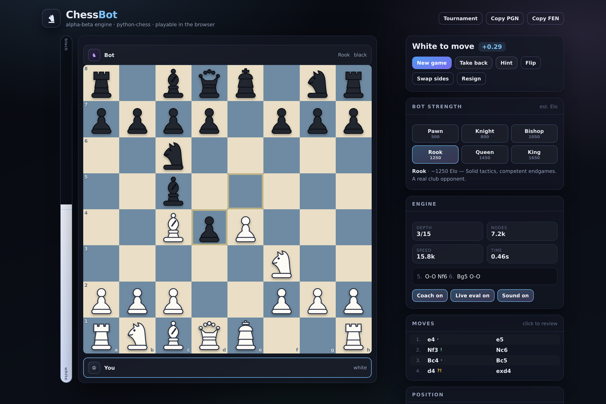

# ♞ ChessBot

A chess engine and two front-ends, all in Python.

It started as a single-file tkinter script with a 3-ply alpha-beta search. It is now a
small but genuine engine — iterative deepening, principal variation search, a
transposition table, quiescence search, tapered evaluation — plus a browser app, a
desktop app, six difficulty levels, an opening book built from real ECO theory, and a
coach that grades your moves as you play.

```
python3 -m web.server      # play in the browser  →  http://127.0.0.1:8000
python3 ChessBot.py        # play on the desktop  (tkinter)
```



<sub>The browser app mid-game, with the coach grading moves as they are played.
There is also a light *Tournament* theme — see [`docs/screenshot-tournament.png`](docs/screenshot-tournament.png).</sub>

---

## What's inside

| Path | What it is |
| --- | --- |
| `engine/search.py` | The search: PVS, iterative deepening, aspiration windows, transposition table, null-move pruning, late move reductions, killers + history, quiescence with delta pruning. |
| `engine/evaluate.py` | Tapered evaluation: PeSTO-style piece-square tables, mobility, pawn structure, passed pawns, bishop pair, rook files, king safety. |
| `engine/book.py` | Opening book: 3,844 named ECO lines indexed by Zobrist hash (so transpositions are handled), with opening names. |
| `engine/__init__.py` | The friendly layer: `Engine`, `Bot` (six levels), `analyse_move` (move grading), `play_game`. |
| `web/` | Browser app: a tiny HTTP + WebSocket server (`web/server.py`) and a dependency-free front end (`web/static/`). |
| `ChessBot.py` | Desktop app (tkinter) — the original entry point, rebuilt. |
| `tests/` | 57 tests, including the search being checked against a brute-force reference implementation. |

## The engine

* **Search** — iterative deepening with aspiration windows; principal variation search
  (null-window scouts, re-search on a fail-high); check extensions; transposition table
  keyed on python-chess' incremental Zobrist hash with mate-distance correction;
  null-move pruning and reverse futility pruning for the easy cutoffs; late move
  reductions for the late quiet moves; killer moves and a history heuristic for move
  ordering; quiescence search that always resolves check.
* **Evaluation** — the usual PeSTO material values and piece-square tables, tapered
  between middlegame and endgame by remaining material, plus mobility, doubled/isolated/
  passed pawns, bishop pair, rooks on open files and the seventh, and king safety that
  only matters while there is material on the board. Scores are mirror-symmetric: the
  engine scores a position and its colour-flipped twin as exact negatives (there is a
  test for this).
* **Speed** — pure Python, so roughly 20–30k positions/second on a laptop CPU: about
  depth 6–7 in a second in the middlegame, and it finds mates and tactics reliably.

```
depth 6: Nf3  score=0    12444 nodes  0.71s  20k nps
depth 7: Nf3  score=+42  24020 nodes  1.20s  20k nps
2s budget: depth 8–9, mates in 3 found instantly
```

## Playing against it

Six levels from *Pawn* (~500) to *King* (~1650). Weaker levels are deliberately human:
they search shallower, think briefly, and **pick a move with a small error margin** —
so they can miss things, but they will still punish a hanging queen at level 1. The
strongest levels always take the engine's first choice.

Every level plays from the opening book, which comes from the public-domain
[chess-openings](https://github.com/niklasf/chess-openings) dataset: 3,844 named lines,
replayed and verified on a board at import time, indexed by position hash. In practice
the bot leaves the book around move 8–9 (median 17 plies of theory) playing real
systems — Najdorf, Berlin, Grünfeld, London, whichever the line leads to — and it
announces the opening it is playing.

### The coach

While you play, the browser and desktop apps ask the engine to grade the move you just
made: `Best move`, `Good`, `Inaccuracy`, `Mistake`, `Blunder`, with the number of
centipawns you gave up and what you should have played instead. The move list colours
each move, and a toast explains a mistake the moment it happens.

## The browser app

`python3 -m web.server` serves a single-page app on `http://127.0.0.1:8000`:

* click or drag pieces; legal targets are dotted; last move, check and selection highlighted
* an evaluation bar, engine depth/nodes/speed/PV readout and the current opening
* live coach grading, hints (drawn as an arrow on the board), undo, flip, swap sides
* review mode — step through the game with ← →, click any move in the list
* load a position by FEN, copy the game as PGN/FEN, two board themes
* if a proxy in front of the app strips WebSocket upgrades, the client falls back to
  plain HTTP requests automatically, so it keeps working (`?transport=rest` forces it)
* keyboard: `N` new · `U` undo · `F` flip · `H` hint · `←`/`→` review

The engine runs server-side on a worker thread; searches are cancellable, so starting a
new game or switching sides never waits for a stale search. The protocol is a tiny JSON
WebSocket (`move`, `hint`, `eval`, `grade`, `cancel`) with progressive `info` frames —
see `web/server.py`. There is also a plain REST API (`/api/move`, `/api/evaluate`,
`/api/analyse`, `/api/levels`, `/api/book`) if you would rather drive it with `curl`.

No build step and no CDN: the only third-party front-end code is
`web/static/vendor/chess.js` (BSD-2-Clause, vendored for legal-move generation and
SAN/PGN handling), which the server serves from disk.

## The desktop app

`python3 ChessBot.py` — same engine, same theme, tkinter:

* board with coordinates, drag-free click-to-move, promotion dialog, hint arrows
* side panel with evaluation bar, engine stats, principal variation and opening name
* move list with coach grades, level buttons, undo/flip/swap sides
* copy PGN/FEN to the clipboard, save the game as PGN, load a position by FEN
* keyboard: `N` `U` `F` `H` `L` (cycle level), `Esc` to clear a selection

Searches run on a background thread and report through a queue, so the window never
freezes while the engine thinks.

## Tests

```
python3 -m pytest tests -q        # 57 tests, ~3 minutes
python3 tests/test_engine.py      # same suite with plain unittest
```

The interesting ones:

* **search vs. reference** — a deliberately naive negamax + quiescence implementation
  (no pruning, no table) computes the same scores as the real, heavily pruned search on
  quiet positions. This is exactly the test that catches pruning bugs and negamax sign
  errors.
* **evaluation symmetry** — 60 random positions must score as the exact negative of
  their mirrored twins; passed-pawn and king-safety terms are checked directly.
* **book integrity** — every one of the 3,844 ECO lines must replay legally, main first
  moves must dominate the distribution, and names may only be as specific as the moves
  played (`1.e4 e5 2.Nf3 Nc6 3.Bb5` is "Ruy Lopez", not a deep sub-variation).
* **levels** — level 6 must always take the engine's best move; level 1 must wander.
* **grading** — depth-deterministic grading, illegal moves rejected, reports serialise.
* **desktop geometry** — all 64 squares round-trip from board coordinates to pixels and
  back, in both orientations, with a tkinter stub so it runs headless.

## Regenerating the opening book

The book data is generated, not hand-written:

```bash
# download a.tsv … e.tsv from github.com/niklasf/chess-openings into ./tsv
python3 tools/build_opening_lines.py ./tsv        # rewrites engine/opening_lines.py
```

## Requirements

Python 3.10+, [`chess`](https://pypi.org/project/python-chess/) (`pip install -r requirements.txt`).
The browser app needs nothing else; the desktop app additionally needs tkinter, which
ships with most Python installers.

## Notes & limitations

* Pure Python means the engine is slow by engine standards — this is a friendly
  opponent and a readable codebase, not Stockfish. Level 6 is a solid club player.
* The level Elo figures are rough labels, not measurements.
* Evaluation terms are tuned by hand and by benchmarks; there is no automatic tuning.
